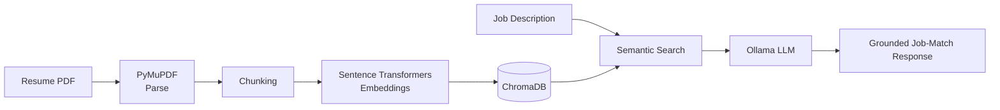
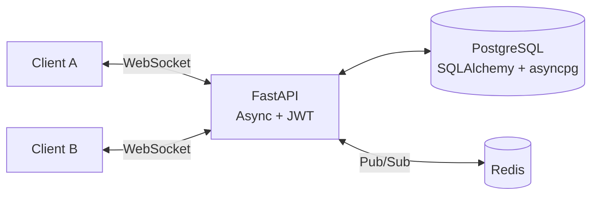

<div align="center">

<h1>Hi, I'm Dharani G 👋</h1>
<h3>Python Backend &amp; AI Engineer</h3>

<a href="https://git.io/typing-svg">
  
</a>

<br/>

<a href="https://linkedin.com/in/dharani1100"></a>
<a href="mailto:dharaniganesan011@gmail.com"></a>


</div>

<br/>

## `~/about`

👋 **Hi, I'm Dharani**, a Python backend developer who enjoys building reliable, explainable **LLM-powered services**.

My work centres on **async REST APIs** and **Retrieval-Augmented Generation (RAG) pipelines**: PDF parsing, chunking, embeddings, semantic search, and local LLMs via Ollama. I care about production-style practices like containerised services, JWT authentication, automated testing with Pytest, and clean, modular code.

```python
class Dharani:
    role      = "Python Backend & AI Engineer"
    location  = "Namakkal, Tamil Nadu, India"
    focus     = ["Async REST APIs", "RAG pipelines", "Local LLMs (Ollama)", "Real-time systems"]
    practices = ["JWT auth", "Pytest", "Docker", "Clean modular code"]
    learning  = ["LLM-powered workflows", "Agentic tooling", "Claude Code"]
    status    = "Open to work"

    def goal(self):
        return "Build reliable, explainable LLM-powered services"
```

<br/>

## `~/tech-stack`

<div align="center">

**Languages**

<p align="center">
  
  
  
</p>

**Backend**

<p align="center">
  
  
  
  
  
  
  
  
</p>

**LLM & RAG**

<p align="center">
  
  
  
  
  
  
</p>

**Data & Messaging**

<p align="center">
  
  
</p>

**Engineering Practices**

<p align="center">
  
  
  
  
  
  
</p>

</div>

<br/>

## `~/featured-projects`

### 🤖 AI Resume & Job-Match Assistant (RAG)


Parses resume PDFs, retrieves the most relevant chunks, and uses a local LLM to produce job-match answers grounded in the resume, not guesses.



**[View repository →](https://github.com/Dharani-G11/REPLACE-WITH-REPO-NAME)**

<br/>

### 📋 Real-Time Collaborative Task Board


Async REST APIs with JWT authentication and PostgreSQL persistence. Changes are broadcast to every connected client in real time using WebSockets with Redis Pub/Sub. Fully containerised and covered by Pytest.



**[View repository →](https://github.com/Dharani-G11/REPLACE-WITH-REPO-NAME)**

<br/>

### 🚗 Ride EXX: Car Rental Website


A responsive car rental website built with HTML, CSS and JavaScript. **[View repository →](https://github.com/Dharani-G11/REPLACE-WITH-REPO-NAME)**

<br/>

## `~/experience`

```text
2025-08 → 2026-02   Product Support Intern        @ SMARTAIL, Chennai
                    · Cleaned and prepared datasets for ML model training
                    · Fixed data quality issues to keep ML workflows reliable
                    · Tested product features, documented and reported bugs

2024-08 → 2025-03   Customer Support Associate    @ Tech Mahindra, Mumbai
                    · Resolved customer issues in a fast-paced environment
```

<br/>

## `~/education-and-certifications`

- 🎓 **B.Tech, Information Technology**: Muthayammal Engineering College (2021 – 2024) · CGPA 7.5
- 🏅 **Claude Code in Action**: Anthropic
- 🏅 **Artificial Intelligence**: NPTEL
- 🎤 Presented a project at a **national-level conference**

<br/>

## `~/github-stats`

<div align="center">


</div>

<br/>

## `~/contribution-snake` 🐍

<div align="center">

<picture>
  <source media="(prefers-color-scheme: dark)" srcset="https://raw.githubusercontent.com/Dharani-G11/Dharani-G11/output/github-snake-dark.svg" />
  <source media="(prefers-color-scheme: light)" srcset="https://raw.githubusercontent.com/Dharani-G11/Dharani-G11/output/github-snake.svg" />
  
</picture>

</div>

<br/>

## `~/contact`

<div align="center">

**Open to Python Backend and AI / LLM Engineering opportunities.**

<a href="https://linkedin.com/in/dharani1100"></a>
<a href="mailto:dharaniganesan011@gmail.com"></a>

</div>
